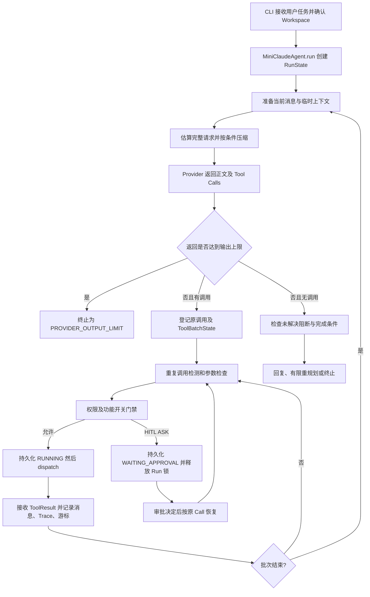

# mini-claude：项目全局、技术演进时间线与证据边界

> 审计基线：GitHub 远程 `main`，`5f41f1d09806ed8a4c387bd80b47a07adaa45609`（2026-10-11 的已推送提交，2026-10-16 核查）。本目录只新增说明文档，不改变运行代码、测试、提示词和验证器。后续远程有更新时，本底稿不是对新 HEAD 的自动保证。
>
> 文档类型：工程历史知识源，不是 README、面试答案或简历材料。所有“当前”均指上述 SHA。“已实现”说明源代码存在且被接入指定运行路径；“已验证”须额外注明测试方式。“历史报告结果”不等于本次重新执行了相同实验。

## 1. 为什么不能把 mini-claude 介绍成一组 Agent 功能

用户的基本任务可以是“在某个仓库中定位失败测试，修改代码，运行验证并交付”。模型本身只返回文本或一个/多个 Tool Call；真正影响结果的是宿主程序能否可靠保存调用、运行 Shell、限定访问目录、区分失败与进展、并在中途暂停或崩溃后知道哪些操作已经发生。mini-claude 的核心演进因此不是“增加更多 Agent 模块”，而是从**模型驱动的循环**，逐步建立**可观察、可约束、可验证、有限恢复的执行环境**。

当前主入口位于 `src/cli/entrypoint.py` / `src/cli/console.py`，主执行器位于 `src/agent/mini_claude_agent.py`。其模型工具声明统一汇入 `src/core/tools/registry.py`，文件/Shell 基础实现放在 `src/core/tools/base_tools.py`，实际工作区语义由 `src/core/runtime_context/` 负责，历史工具结果和治理判断写入 Trace；可选 SQLite Checkpoint、持久化审批只保护**主 Agent 已通过指定入口创建的前台工具批次**。所谓 `Skills` 是文件发现、描述展示与内容加载的扩展能力；当前主线没有经源码证实的 MCP Client/Server 或 Plugin Runtime，不应将“理解 MCP 概念”写成“项目已接入 MCP 生态”。

一条正常的当前执行流程：

注意：图中持久化阶段仅在显式启用 Checkpoint/HITL 时发生；默认运行只维护内存状态。图展示函数关系，**不是对一次真实执行日志的声称**。对应主路径可从 [`run()` 和循环入口](https://github.com/huwuhu6/mini-claude/blob/5f41f1d09806ed8a4c387bd80b47a07adaa45609/src/agent/mini_claude_agent.py#L416-L438)、[`_llm_tool_cycle_impl()`](https://github.com/huwuhu6/mini-claude/blob/5f41f1d09806ed8a4c387bd80b47a07adaa45609/src/agent/mini_claude_agent.py#L2298-L2600) 和 [`_execute_tool()`](https://github.com/huwuhu6/mini-claude/blob/5f41f1d09806ed8a4c387bd80b47a07adaa45609/src/agent/mini_claude_agent.py#L1704-L1798) 追溯。

## 2. 可核验版本边界

核验时，远程 `main` 直接指向 `5f41f1d`；先前作为“可能只在本地”的 `RunState`、Snapshot、SQLite、HITL Runtime 与 HITL CLI 实际已在远程提交链上。远程另有 `codex/structured-memory-integration`、`feat/structured-context-memory`、`experiment/pre-mutation-shadow-detector`、`feat/semantic-oscillation-completion-v4`、`docs/interview-prep`、多个 `fix/` / `refactor/` 分支。**分支存在不代表其内容在当前主线启用**；本文一律以本次远程 `main` 的运行路径核查。仓库存在带注释 Tag `v1.0.0`，其 tag object `0a622812` 指向 `f3044da77296cd50ad9bb20d54d6fc47809e4213`，是第一次模块化 Runtime 版本的明确时间锚点。

另一个起点必须保留证据缺口：README 及早期 Tag 说明声称从约 740 行 `s_full.py` 单文件原型改造，但当前远程主线的递归文件树**没有 `s_full.py`**，初期提交的 `.gitignore` 甚至忽略此文件。本次不能逐行复原单文件时期原始 `agent_loop`，只能引用当时提交说明与模块化后的历史代码；若要做到“最初每行如何实现”，仍需原始文件或独立历史归档。早期提交描述中的“Shadow Workspace + 2PC 回滚”也须视为**提交声称**而非现在所有工具均具备通用事务回滚的证明。

## 3. 一条贯穿项目的时间线

| 时段 | 可追溯证据 | 发生了什么 / 为什么重要 | 后续独立章节 |
|---|---|---|---|
| 2026-05-10~12 | `f3044da`、Tag `v1.0.0` | 从单文件设计迁移到 CLI、模型 Provider、主 Agent、工作区与 Shell、失败分类、Trace、基础评测框架；不能从 Tag 宣称所有扩展已经成熟 | [01](01_Agent循环与失败治理.md)、[02](02_工具执行与扩展边界.md) |
| 5 月中下旬 | `ff3add9`、`f7073c9`、`a99cb2c`、`4d8cc16` | 从重复命令软提示走向命令归一化、Guard 与熔断；出现误杀合法重试和上下文持续膨胀的双重问题 | [01](01_Agent循环与失败治理.md)、[03](03_上下文工程与Prompt演进.md) |
| 6 月至 8 月初 | `63a1c28`、`a799c86`、`500ee5b`、`be9aae0` | 统一 Shell 能力；建立任务来源哈希、校验先行和跨版本不可比警告 | [02](02_工具执行与扩展边界.md)、[06](06_评测体系与证据可信性.md) |
| 8 月中旬 | `d360134`、`2dd60c2`、`b115d5b` | 长输出文件化；从“所有输出直接塞进上下文”转成保留诊断入口；多语言环境错误与循环控制暴露更多差异 | [01](01_Agent循环与失败治理.md)、[03](03_上下文工程与Prompt演进.md) |
| 9 月上中旬 | `7648e64`、`91a1efd`、`ec3050b`、`491a150` | 通过真实失败与误停用例把多个 Guard 证据收敛到 `AttemptEvent` / `RuntimePolicy`；同时修复评分验证器的信任边界 | [01](01_Agent循环与失败治理.md)、[06](06_评测体系与证据可信性.md) |
| 9 月末 | `06b28ea`、`c682808`、`066c364`、`adcaa3c` | Agent 工作笔记、完整请求 Token 预算、输出截断防护、Harbor 适配、Provider 流式完整组装 | [03](03_上下文工程与Prompt演进.md)、[06](06_评测体系与证据可信性.md) |
| 10 月 1~2 日 | `9dad692`、`330e11d`、`677c925`、`389f5e4`、`9965ffc`、`eb1b021`、`8c7af3e` | 统一 Tool 注册；CLI 从 Runtime 剥离；静态 Prompt 独立；冻结尚未闭环的多 Agent；重新接入 Todo；修复 Tool Observation | [02](02_工具执行与扩展边界.md)、[03](03_上下文工程与Prompt演进.md) |
| 10 月 10 日 | `c158978`、`3f61cee`、`123586a`、`a3ef6b3`、`f6ff257` | 工具消息闭环、运行期能力检查、Shell cwd 语义，随后出现进程内 Run/Batch 游标与可移交 JSON Snapshot | [04](04_RunState快照与Checkpoint恢复.md) |
| 10 月 11 日 | `d892ed3`、`2518787`、`f069085`、`342a523`、`5f41f1` | 从受控移交上升为有持久化副作用日志的保守恢复，再接入权限契约、HITL Runtime 和 CLI 审批 | [04](04_RunState快照与Checkpoint恢复.md)、[05](05_HITL审批与执行安全.md) |

提交的完整引用应打开 [main 提交历史](https://github.com/huwuhu6/mini-claude/commits/main/) 按 SHA 定位，不能仅按日期推断一段改造完全由某次提交独立构成。

## 4. 证据覆盖矩阵及阅读顺序

| 主线 | 现行源码 | 历史差异 / 演进记录 | 确定性测试 | 真实模型 A/B | 核心缺口 |
|---|---|---|---|---|---|
| Agent Loop 与治理 | 强 | 强：`docs/evolution/tool_deduplication.md`、`anti_loop_benchmark_audit.md` | 有 | 有阶段性 DEV 结果，但最终版本未完成同条件全面复测 | 新 `main` 的全面动态稳定性 |
| Tool、Workspace、Shell | 强 | 强：`tool_registry.md`、`polyglot_environment_guard.md` | 有，平台覆盖有限 | 长日志任务提供间接观察 | 进程/文件系统沙箱、跨平台实测 |
| MCP / Skill / Plugin | Skill Loader 可读；MCP 集成未找到 | Skill 有历史 | 部分功能测试 | 无 | MCP Client/Server 及权限边界未实现/未核实 |
| 上下文与 Prompt | 强 | `context_management.md`、`tool_deduplication.md` | 有 | 长日志成对 5 次试验；Harbor 单样本失败 | 不能对所有 Coding Task 外推 Token 提升 |
| JSON / SQLite 恢复 | 强，需显式开启 | `tool_registry.md` 分阶段记录 | 独立进程模拟与故障注入 | 无付费 Provider | UNKNOWN 人工处理、外部副作用事务 |
| HITL | 强，需显式开启 | 7A/7B/7C 三次实现提交与 CLI 记录 | 有，最终 646 passed / 12 skipped / 4 failed 为历史报告 | 无真实付费模型端到端 | 身份认证、OS 沙箱、跨平台/人工终端 |
| Evaluation / Harbor | 强 | `evaluation_evolution.md`、`anti_loop_benchmark_*` | 有 | 含失效试验及 Provider timeout | 多数原始动态输出未随仓库跟踪 |

推荐先读本总纲，然后按 [01](01_Agent循环与失败治理.md)→[02](02_工具执行与扩展边界.md)→[03](03_上下文工程与Prompt演进.md) 理解基础执行及模型观察，再读 [04](04_RunState快照与Checkpoint恢复.md)→[05](05_HITL审批与执行安全.md) 理解“工具不能重复做”的含义，最后读 [06](06_评测体系与证据可信性.md)、[07](07_证据索引与遗留问题.md) 及 [08](08_用户补充原始评测归档审计.md) 审查结论到底被何种实验支持。

## 5. “现在有什么”的准确范围

当前项目定位是**本地、单机为主的 Coding Agent Runtime 实验项目**，不是可多租户运行的生产级 Agent 平台。执行 Shell 的 `CommandPolicy` 和 `WorkspaceAuthority` 能对路径与明显危险命令做应用层检查，但不构成不可绕过的操作系统隔离、事务化文件系统或容器沙箱。运行中的大型外部进程、遗留文件变更与 SQLite 不能保证统一提交。恢复依赖同机同数据库、同工具实现及执行上下文的严格兼容检查；合法继续的边界很窄，有意拒绝“看起来可能已经成功”而直接重放。

两组容易污染历史叙事的陈述必须纠正。其一，README 同时出现“已支持 `/resume`”与后段“没有 Resume CLI”，后者是旧段落未同步更新，现行 `src/cli/hitl_commands.py` 和 7C 提交证明有显式恢复命令。其二，用户曾记得“执行轮次 26.3→19.7、耗时 82.9→63.2”，当前已读取的受控实验摘要尚不能建立这两个具体数字与固定代码版本/原始 Trial 的对应；本套底稿不将它们列为正式效果。

## 6. 用户补充原始证据（2026-10-18）

用户后来补充了完整 Unified Anti-Loop Baseline/Candidate/V2 Benchmark 归档，以及 Prompt、结构化记忆与 TodoWrite 的 Harbor 原始 Trial。已核对逐项 Manifest/Results/Trace 并在 [08_用户补充原始评测归档审计](08_用户补充原始评测归档审计.md) 中复算 36+36 Trial、记录 Worktree dirty 和 Verifier validity incident。此前 00—07 章中关于这些试验“原始归档当前缺失”的表述以 08 章的最新补证为准；用户明确不再追溯 `s_full.py`，不将其列为后续必补材料。

## 7. 不可混用的四层事实

**源码事实**描述具体方法如何运行，必须标明 SHA。**提交事实**证明某种改动曾出现，未必证明后来仍启用。**测试事实**例如“新增 45 项通过”，限定为该测试集和运行环境；历史日志的 reported pass 不代表本次会话又执行了一遍。**真实模型评测事实**须同时检查任务来源哈希、版本/配置、样本数、Verifier 和 Provider 是否可用；单任务低成本不意味着 Coding Agent 整体更强。

各专题据此保留失败、弃用、配置默认关闭、证据缺失，并引用可定位的代码与提交。这也是与纯功能介绍最大的区别。

## 简历与面试准备入口

完成工程演进学习后，使用 [09_简历写法与面试核心问题索引](09_简历写法与面试核心问题索引.md) 查看建议的简历项目描述、P0 核心问题清单和牛客真实面经来源。01—06 篇各自末尾也已增加简历写法与分级面试问答。
