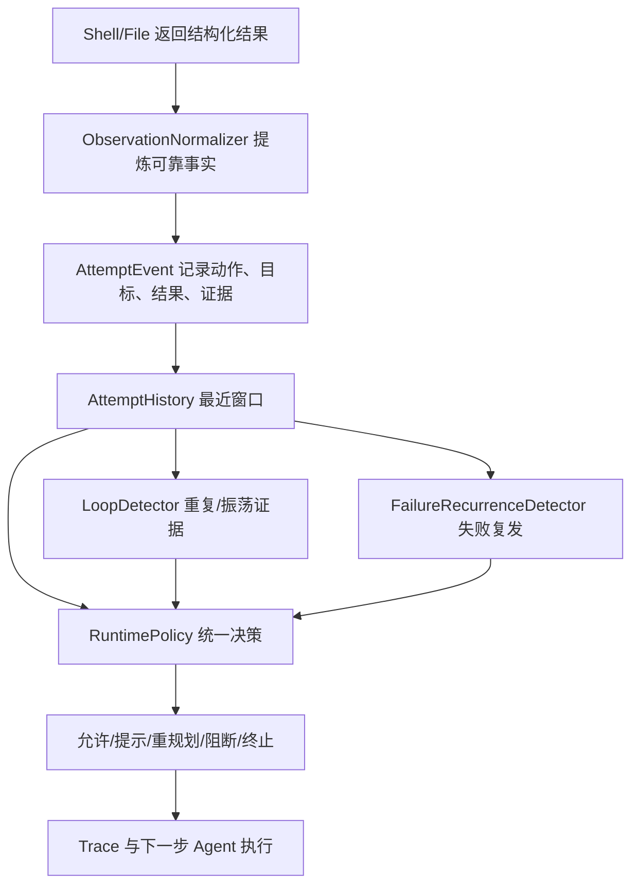

# Agent 执行循环与失败治理：从重复命令到统一运行策略

> 当前代码基线：`5f41f1d09806ed8a4c387bd80b47a07adaa45609`。代码证据主要位于 `src/agent/mini_claude_agent.py`、`src/core/loop_controller.py`、`src/core/loop_guard.py`、`src/core/runtime_context/observation.py`。历史材料：`docs/evolution/tool_deduplication.md`、`anti_loop_benchmark.md`、`anti_loop_benchmark_audit.md`。演进阶段不是全部根据提交标题推断的，以下分别列明源码路径与历史报告。

## 1. 最初要解决的是“模型只能提议，程序必须执行”

Coding Agent 收到“定位测试失败并修复代码”，首先需要获取源码、执行测试、读取报错、编辑、复跑。早期单文件模型循环的常见流程是请求模型、识别 Tool Call、执行、将结果作为 Observation（工具观察反馈）附回消息、再请求模型。mini-claude 自述起点为单文件 `s_full.py`，但当前远程主线不包含它，因此无法逐行恢复最早循环的停止条件或工具错误处理；唯一可确认的早期时间锚是首个模块化 Tag `v1.0.0` 对应的 `f3044da77296cd50ad9bb20d54d6fc47809e4213`。现阶段不能把“推测中的单文件实现”写成当时真实代码。

模块化后主循环在 `MiniClaudeAgent` 中迭代，模型 Provider 返回正文和 `tool_calls`；程序检查调用、分派 handler、回填对应 `tool_call_id` 的结果，再走下一轮。**Tool Call 是模型的请求，不是已经执行的事实**。这个差异后来直接催生 RunState、审批与执行日志。当前的函数关系为 `run()` → `_llm_tool_cycle()` → `_llm_tool_cycle_impl()` → `_execute_tool()` → `ToolRegistry.execute()` → handler；发生完整工具结果后再将 `role=tool` 结果回填历史。它不是每次工具调用都向模型发一次请求：同一模型响应可以包含多个有序 Tool Call，一个批次运行完才继续下一次模型调用。

### 1.1 当前一次工具批次如何闭合

在 `_llm_tool_cycle_impl()`（约第 2298 行）中，程序先构造临时上下文和待发送消息，估算包括 System Prompt、Tool Definitions 和消息的请求 Token，再判断压缩。Provider 的 `create_message` 响应解析为正文、调用、`finish_reason` 和 `usage`。如果 `finish_reason` 表示输出达到上限，调用不会被当作完整结果执行：Runtime 以 `PROVIDER_OUTPUT_LIMIT` 失败终结。若没有 Tool Call，可能先根据 `require_tool_call` 进行一次有界催促，再由 Completion Gate 检查未解决的阻断，决定完成、重新规划或者阻断。若存在 Tool Calls，则先把保留原 ID 的 Assistant 消息登记到消息列表，再创建 `ToolBatchState`，之后逐项执行。

以说明性场景为例（**以下是机制示例，不是已存档的一次真实 Trace**）：Provider 同轮返回 `read_file(config.py)`、`bash(pytest)` 两项。如果第一项执行并写入结果，随后任务受控暂停，第二项不能因为“下一轮继续”被重新生成：RunState 持有 `next_call_index=1`、已完成结果和原始第二项的 Provider Call ID。恢复时只执行第二项，然后闭合批次。代码分别位于 `src/core/run_state.py` 的 `ToolBatchState.record_result()` 和 `mini_claude_agent.py` 的恢复批次分支。涉及真实文件编辑时，下一阶段的 Checkpoint 还需要判断“第一项是否已造成副作用但结果尚未提交”，不能仅凭聊天记录推断。

在异常、取消或策略提前终止时，`_close_tool_call_batch()` 也为尚未执行的原始 ID 写入 `NOT_EXECUTED`，对结果无法确认的当前调用写 `UNKNOWN`，避免模型消息序列留下孤立的 Tool Call。该处理的直接原因是 OpenAI 兼容消息格式要求 Tool Call 与工具结果能正确关联；模型可见的“失败原因”也必须与执行事实一致。这里的“闭合”只是**协议完整性**，不等于业务操作成功，也不等于持久化事务已提交。

## 2. 第一阶段：同一回复去重仍挡不住跨轮空转

早期资料 `docs/evolution/tool_deduplication.md` 保存了两个明确的重复调用观察：同一次 Assistant 回复可以重复调用相同 Shell；跨轮也曾在约三秒间隔内重复执行同一个缺乏有效输出的 Python 命令。旧思路为同轮 `seen_tool_sigs`，按工具名和参数签名检测重复；它能避免**一个响应内部的完全相同调用**，但不能理解模型下一轮换一种 Shell 拼写重试同一个无效操作。对重复命令加软性反思提示，则依赖模型遵循提示。若模型持续尝试，系统仍会消耗模型调用、工具执行与时间预算。

此处重要的取舍是：**“重复命令”不等于“无进展”**。例如等待服务初始化时重复 health probe，或修复测试过程中反复执行同一条 pytest，可能因环境状态或源码变化产生有意义的新信息；直接采用“同一命令三次就硬禁止”会误杀正常 Debug。于是历史方案从短窗口签名、软提示继续演进到 `LoopGuard` 和命令意图归一化，代表提交包括 `a99cb2c`、`f7073c9`、`ff3add91`。归一化把命令参数差异映射为更可比较的动作/目标，但也产生另一个危险：不同 grep 关键词或不同 sed 行范围可能被压成相同意图，造成误拦截。2026-09-29 的治理修订明确放开这些合法的不同观察，不将同一意图签名直接等同于无进展。

同轮去重当前仍存在，但实现比历史示例更谨慎：`ToolBatchState.seen_signatures` 与当前批次一起维护，跳过重复项时仍生成带原 Call ID 的 `SKIPPED_DUPLICATE` 工具结果并推进游标。审核时应检查签名使用的原始参数字符串这一细节：不同 JSON 键顺序有可能表现为不同原始串，因此不能笼统声称所有语义等价 Tool Call 都能被统一去重。

## 3. 第二阶段：Shell 的“执行成功”并不是业务成功

真正难的问题不是重复命令的格式，而是**工具返回的成功标记究竟代表什么**。历史 Anti-Loop 审计指出，Shell 若执行 `curl ... & echo OK`，最终包装进程退出码可能为 0，但实际服务返回了 HTTP 503；如果 Runtime 只看最后一条 Exit Code，就会把探测过程当成成功，错误地关闭未解决故障。相反，`stderr` 中出现一段字面字符串“Permission denied”也不必然证明当前目标访问被拒绝，它可能只是 grep 找到了 README 里的说明。

因此后续 `ShellSession`、`ToolResult` 和 `ObservationNormalizer` 分离了三个事实：

- **执行层事实**：进程 `exit_code`、`stdout`、`stderr`、`timed_out`、`cancelled`、可保守确认的 `segment_exit_codes`。
- **观察层事实**：HTTP 4xx/5xx、健康检查、工具链/资源不可用、明确 traceback 等在对应工具上下文中可归因的失败证据。
- **LLM 可见文本**：为了有限上下文返回的摘要或文件化日志预览，未必包含全部原始输出，不该反向成为唯一事实来源。

这三层允许 `execution_success=true` 与 `observed_failure=true` 同时存在：运行命令本身成功结束了，但对目标服务的观察失败。`8c7af3e` 的工具观察可靠性修订、`123586a` 的 Shell cwd/环境语义补丁都是这一方向。`src/core/runtime_context/observation.py` 和 `src/core/tools/base_tools.py` 要结合阅读，不能仅凭 `ToolResult.success` 证明请求的业务目标已达到。

一个具体的根因链：如果 HTTP 503 被包装命令后续 `echo` 的退出码掩盖，旧控制层从未拿到失败事实；即使把 LoopGuard 阈值调低，也只是改变错误事实的使用频率，不能修复事实丢失。后续优先修复观察数据契约，再谈停止与恢复策略，正是这个工程顺序。

## 4. 第三阶段：多个 Guard 各自累计失败会产生矛盾

此前控制链里存在短窗口 `LoopGuard`、失败记忆、环境阻断计数、Workspace 停滞判断及后来的 Progress Governance。历史审计记录过 `edit → test → edit → test`：中途已经修改源代码，旧测试失败仍可能在某个累计计数中触发熔断。另一个反例是启动时网络处于 OFFLINE，后来网络恢复，却被旧环境快照长期阻断。问题不只是策略“严格”，而是**每个控制器拥有各自的历史解释权**，同一工具尝试可以在一个模块表示进展、另一个模块表示持续失败。

2026 年 9 月的改造把工具尝试统一成 `AttemptEvent`，由 `AttemptHistory` 维护顺序流（默认最近 32 条），在 `RuntimePolicy` 上做统一决策。`src/core/loop_controller.py` 中的核心组织如下：

此图是当前组件关系的逻辑展示，不意味着所有类别都拥有百分百准确的通用语义理解。统一事件的价值在于让动作、观察和终止归因共享一套顺序事实，便于回放；并不保证“只要代码变化就必然有有效进展”。

进一步的修订明确**目标身份不能等同于工具调用意图**：`curl localhost:8080/health` 与 `health_check(port=8080)` 可能验证的是同一服务，但 Tool 类型不同；`pytest tests/user` 和 `pytest tests/order` 则不能因为同为 pytest 就判为同一失败域。因此增加 `subject_key`，在能够可靠提取的范围按服务 host/port、测试 scope 或包名等建立关联；没有结构化正向证据时不自动消除阻断。无关的 `echo READY` 或修改 README 不能“洗掉”HTTP 503 或未通过的测试。

## 5. 第四阶段：完成声明需要与真实阻断状态核对

早期模型可以在工具探测失败后直接回复“已完成”，而实际上环境依赖根本不可用。当前无工具响应会进入 `_RuntimeCompletionGate`，基于 Runtime Policy 的最近失败与未解决阻断决定接受完成、给予有界重新规划机会或标记 `UNRESOLVED_BLOCKER_COMPLETION`。这里的目标是降低“用户看到成功文字但业务目标未完成”的假阳性；它**不是一个可以证明任意功能正确性的通用验证器**。真正的业务成功仍依赖测试、Verifier 和目标系统的可检查不变量。

对“应该停止”的任务，Runtime 既不能无限重试，也不能在可恢复错误出现一次后立刻拒绝。错误发生时必须区分当前操作失败、业务阻断、是否存在相同目标的正向恢复证据，以及模型是否已经进行过重规划。本文仅将项目实际验证过的 resolver 纳入已实现范围：同意图或同可核实 subject 的部分成功证据；没有资源拓扑证明时，不宣称支持任意跨模块/跨环境因果关联。

## 6. 实验如何证实、又在哪里不成立

`docs/evolution/anti_loop_benchmark.md` 中的旧冻结基线 DEV×3、36 个 trial 记录 TP=3、TN=14、FP=4、FN=15，对应 Governance Accuracy=17/36=47.22%，False Stop Rate=4/18=22.22%。它证明当时存在显著治理误判，并非新主线的最终性能基线。

统一 Attempt Event 阶段的历史文档 `docs/evolution/anti_loop_benchmark_audit.md` 记录 DEV×3 Stop Recall 从 11/18（61.11%）到 13/18（72.22%），False Stop 均为 0；Verifier Pass 从 22/36 到 24/36。但是后续还发生 verifier 可信性修复、Provider 超时和其他边界变更，不能直接把这一阶段的对照写成 `5f41f1d` 最新版本的通用提升。

另一个较新 Candidate DEV×1 仅有 12 次，TP/FP/TN/FN = 5/0/6/1，但其中 3 次为基础设施错误。这个结果不能证明长期稳定，也不能推算没有基础设施故障时的真实成功率。部分旧文档包含看起来更漂亮的聚合成本数字，但任务集 `hash` 不同（`eval_reports/anti_loop_refactor/comparison.md` 已明确警告），严禁作为严格代码 A/B 使用。完整区分见 [06_评测体系与证据可信性](06_评测体系与证据可信性.md)。

## 7. 当前方案的边界与后续因果

当前 `RuntimePolicy` 可以统一解释部分动作/观察/失败证据，但“源码更新”只是弱进展线索，“同 subject 成功”也并不通用地等价于目标业务达成；测试覆盖集的包含关系、跨模块 fallback、外部健康与业务端点的联系，都不可能仅靠命令文本完全证明。工具执行与消息写入还可能发生崩溃，不属于 LoopController 的职责。2026-10-10 之后项目才进入显式 RunState 与 Checkpoint 阶段，将“模型决策正确”进一步扩展为“已经执行的操作在重启时不能莫名其妙再次执行”。接着阅读 [04_RunState快照与Checkpoint恢复](04_RunState快照与Checkpoint恢复.md)。

核心可迁移结论：**先证明工具实际观察了什么，再建立统一的尝试历史，最后决定是否重试、终止或允许完成**。反过来先改熔断阈值，既无法修复错误事实，也可能误杀正常的重复验证。
