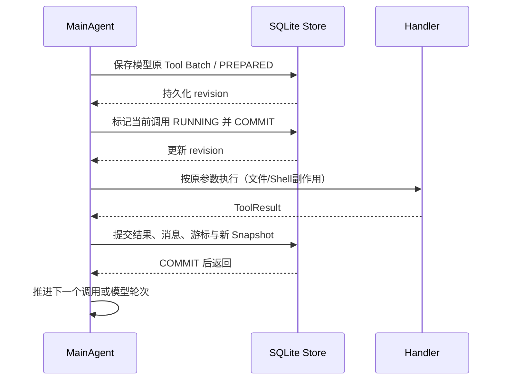

# RunState、JSON Snapshot 与 SQLite Checkpoint：从受控暂停到保守故障恢复

> 版本 `5f41f1d09806ed8a4c387bd80b47a07adaa45609`。源码：`src/core/run_state.py`、`run_snapshot.py`、`checkpoint_store.py`、`src/agent/mini_claude_agent.py`。演进：`docs/evolution/tool_registry.md` 中 2026-10-10~11 的分阶段记录、`docs/HANDOFF.md`；测试包括 `test_run_state.py`、`test_run_snapshot.py`、`test_checkpoint_store.py`、`test_checkpoint_runtime.py`、`checkpoint_process_probe.py`。重要前提：当前实现**显式开启** SQLite 才具备相应持久化语义，默认模式仍主要是进程内状态。

## 1. 为什么会话记录不等于任务可继续

Agent 已经有 Session Recorder 和 Trace，它们能记下用户消息、模型轮次与工具观察，但这不代表“现在还能从哪里安全继续”。例子：模型一次发出 A=读配置、B=改配置、C=运行测试；A 已完成后用户受控暂停。下次继续不能重新把“读过的消息”交给模型让它再生成 B 和 C，因为重新生成的调用 ID、参数或顺序可能不同；也不能从头执行 A/B/C，因为 B 可能产生重复写入。更危险的是 B 已进入 Shell/文件 handler 并修改了文件，进程却在结果保存前被杀死：Session/Trace 可能没有最终工具结果，却不能因此断定 B 没执行。

这引出三个不同的事实源：
- **RunState** 表示当前任务进程内的运行生命周期、模型轮次预算、原始 Tool Batch 及执行游标。
- **Snapshot** 是在某个安全边界按契约序列化的逻辑状态，给受控移交和兼容性审查使用。
- **Execution Journal + Checkpoint** 记录原始调用是否准备、已经进入执行、结果是否提交，并把 Snapshot 与这个事实日志绑定到 SQLite 事务和执行独占权。

这三者不是替代关系。特别是工具调用外部副作用与 SQLite 无法共享事务，因此 Checkpoint 的最重要原则不是“什么故障都自动恢复”，而是**遇到无法确认已执行与否的调用，拒绝自动重放**。

## 2. 第四阶段：先让运行状态显式化

提交 `a3ef6b34d`（2026-10-10）在主 Agent 中加入 `RunState` 与 `ToolBatchState`。`RunState` 保存 `run_id`、`status`、`max_iterations`、`model_turns_used`、`no_tool_retry_count`、`tool_call_seen`、当前批次、暂停请求和对应的 `trace_task_id`。它是一次 `run()` 的身份，不是 Session ID，也不是 Trace task ID。原始模型 Tool Call 列表在 `ToolBatchState` 内深拷贝；另有 `assistant_message_index`、`model_iteration`、`next_call_index`、`results`、`resolved_call_ids`、`seen_signatures`、`pending_replan_messages`、`finalized`。

为什么必须分别保存“下一调用索引”和“已完成结果”：单看索引无法证明对应 Tool Result 消息已经写入；单看结果映射则无法证明调用是否按模型顺序执行。`ToolBatchState.record_result()` 先检查当前 `RunStatus=RUNNING`、批次可以推进、传入 Call ID 必须与 `next_call_index` 的 Provider ID 相同、该 ID 尚未记录；之后保存结果并递增游标。若用户要求暂停且后续有未执行 Call，将状态变为 `PAUSED`。下一次 `_continue_run()` 不添加新的用户消息、不重置 Todo/预算，不重新请求模型生成这批待执行调用。

它解决的是**同一实例内受控继续**。突然杀死 Python 时，进程内这些字段仍全部丢失，因此这时还不是故障恢复。

## 3. 第五阶段：JSON Snapshot 是一次安全边界上的逻辑状态

`f6ff2571fa2a8f0d826a7a83a1a8ea6b21bfd8a1` 在此基础上引入版本化 Run 快照及新实例恢复。`src/core/run_snapshot.py` 使用 `encode_run()` / `decode_run()` / `decode_messages()`、`json_copy()`、字段和类型校验来强制快照契约；`MiniClaudeAgent.export_run_snapshot()`、`restore_run_snapshot()` 负责汇总/核查实例上下文。快照不应只是 `messages`：需要原工具批次、游标、已完成结果、系统和工具兼容性摘要、工作区当前语义、模型调用预算等信息，才能判断导入后是否能安全接续原调用。

例如 A 已完成、B 尚未执行，导出边界应保留 A 对应 Tool Result 与 B 原 Tool Call 的完整身份。新实例导入后先验证工作区与代码/工具/配置兼容性，再只执行 B；不是“把最后一句话重新发给 LLM”。如果在快照导出后有用户/其他进程改了 Workspace，`_continue_run()` 对 `workspace_checkpoint_digest` 与当前内容摘要重新比较，发现漂移就 fail closed。注意这种核对无法封住“校验通过之后、执行之前再次被外部改变”的所有竞态。

此阶段限制同样明确：JSON 文件可以被复制到两个新实例，若两者都认为自己是合法继续者，就可能重复执行 B。JSON Snapshot 也不管理进程突然死亡时 B 是否已经调用过 handler；对外部副作用没有事务保证。历史专项 54 passed、扩展 260 passed/12 skipped、完整单测 419 passed/12 skipped/4 failed 是当时 Windows Python3.14.3 上的已有测试报告，**不是本次重跑**。

## 4. 第六阶段：为什么需要 SQLite Journal，而不只是将 Snapshot 写入数据库

`d892ed3d27c3269bc6843d959634a0e4b11c80d2` 引入 `SqliteCheckpointStore`。如果只存 Snapshot，进程在“开始执行命令”到“保存工具结果”之间退出时，保存的游标仍指向 B；重启就可能再次执行 B。为识别这一窗口，`calls` Journal 采用可理解的阶段：`PREPARED`（原 Tool Call 已可靠记录但尚未开始）、`RUNNING`（调用前已持久化进入执行阶段）、`COMPLETED`（执行结果与快照确认提交）、`NOT_EXECUTED`（明确没有执行）、`UNKNOWN`（执行曾开始，但结果无法判断）。`runs` 同时保存整体 Run 身份、revision、状态、快照内容及哈希、Journal hash 和最终结果。模型轮次 `turn`、批次内 `ordinal` 与 Provider Call ID 共同校验原始调用身份。

一次成功的正常调用至少经历：

图中提交动作必须与当前源码的 `save_snapshot()`、`mark_running()`、`_checkpoint_dispatch()` 结合阅读。对于 SQLite 模式，`MiniClaudeAgent._checkpoint_dispatch()` 在调用真实 Registry handler **之前**验证当前 Run、批次和原参数，然后通过 Store `mark_running()` 提交状态。完成后循环通过 `_checkpoint_save("tools")` 保存结果及游标。实现的确会增加数据库写事务：这是为了得到可审计的故障边界，不是零成本可靠性。

## 5. 崩溃发生在哪个时刻，决定能否继续

| 中断位置 | 数据库可见事实 | 下次恢复允许做什么 |
|---|---|---|
| 模型返回并完成 PREPARED 提交，尚未进入 handler | 当前调用 `PREPARED` | 通过锁/兼容性校验后可继续原调用 |
| `RUNNING` 事务已提交，Handler 尚未真正启动 | `RUNNING` | 即使这次事实上尚未执行，也按不确定处理，不自动重放 |
| Handler 已写文件或执行命令，Result 尚未提交 | `RUNNING` | 标记 `UNKNOWN`，要求人工核实副作用 |
| Handler 返回成功并且 Result / cursor 事务完成 | `COMPLETED` 与结果 | 按已提交前缀跳过，不重复调用 |
| 结果已保存但下一个模型请求尚未开始 | 完整结果前缀与 `before_model` 边界 | 保留消息闭环，重新开始下一模型轮次 |
| Run 终结结果已经提交 | 终结状态与 `final_result` | 重复恢复只返回已保存结果，不执行任何新工具 |

关键实现位于 `SqliteCheckpointStore.recover()`：若 Journal 留有 `RUNNING`，持有 Run 锁的恢复者先把它转 `UNKNOWN`，Run 状态改为 unknown；`MiniClaudeAgent.resume_checkpoint()` 会拒绝自动再次执行。SQLite 本身无法和文件系统修改、远程 API 请求或外部 Shell 子进程做一笔原子事务，因此**从 RUNNING 回到 UNKNOWN 是正确但保守的失效处理**。在“标记 RUNNING 成功但真正 handler 尚未运行”时也会产生假保守阻断：用可用性换取不制造重复副作用的安全性。

## 6. 两个独占问题：谁拥有 Run，旧内存为什么不能继续

`SqliteCheckpointStore` 使用本地持久锁文件/OS 进程锁来保证同机同数据库的 Run 独占推进；写操作通过 `_owns()` 校验当前线程/进程拥有对应锁，SQLite 使用 `BEGIN IMMEDIATE` 事务。`runs.revision` 作为乐观版本 CAS，防止先前取得状态的旧实例在另一实例推进后覆写新状态。每次写入还会计算 Journal 哈希和快照哈希，`load()` 在同一读取事务中对日志、原始调用、快照结果/游标、审批边界进行一致性检查。

为什么不能只加 Lock：即使锁在进程死亡后释放了，旧实例的内存仍可能过期；或者某次提交实际上成功但 API 返回异常。CAS 防止“旧版本再次成为真相”，日志记录让新进程可以从数据库判断已经发生到哪一步。注意这只是**同机、可信数据库**协议，不具备跨机器租约、数据库外副作用 exactly-once 或对任意不受信任文件篡改的全面防护。

## 7. SQLite COMMIT 失败为什么必须隔离当前实例

`SqliteCheckpointStore._write()` 在事务里写事实并记录 `last_operation` token；如果提交抛异常，尝试用**新连接**查看该 token 是否已经落库，区分已提交、未提交或无法确定。即便独立检查发现 COMMIT 已成功，当前 Agent 实例也会 `_checkpoint_faulted=True` 并停止继续执行。原因在于应用层异常发生的瞬间，内存 `revision`、调用游标和数据库权威事实可能不一致；如果“数据库看起来提交成功就让旧实例接着跑”，仍可能重复分派或覆盖结果。新进程必须通过加载数据库和检查原始身份重新建立可信状态。

数据库可疑、源码指纹变化、功能开关更改、工作区摘要不匹配、cwd 不可访问、工具 handler 来源改变都应拒绝恢复，不能因为“用户急着继续”就跳过。存储路径要求在 Workspace 之外，避免 Agent 自己的文件修改轻易覆盖权威 Checkpoint，仍然不代表磁盘内容加密或用户认证。

## 8. Status/ID 的含义不能混淆

`session_id` 是交互会话日志身份，帮助复盘对话；`trace_task_id` 是 Trace 系统对一个任务过程的诊断身份；`run_id` 是运行生命周期身份，Checkpoint 的 `runs` 主键；Provider 的 `tool_call_id` 标识模型返回的一个具体 Tool Call；`turn` 与 `ordinal` 确定它在当前 Run 内的位置。`checkpoint_id` 并非本项目当前恢复入口要求用户传入的独立身份；实际 CLI 是 `/resume <Run ID>`。若新文档为了与别的 Agent 框架类比而虚构 `checkpoint_id` 主键，会误导当前数据库数据模型。

## 9. 真实验证与不能宣称的能力

`docs/evolution/tool_registry.md` 第六阶段记载 Windows Python3.14.3 完整 `tests/unit` 477 passed、12 skipped、4 failed；新增 Checkpoint Store 22 项与 Runtime 36 项通过，定向 164 passed、10 deselected，LoopController integration 35 passed。独立进程测试包含进程在 PREPARED/RUNNING/结果提交前后退出、完成后再恢复、进程锁互斥与副作用观察；但这些测试使用 Mock Provider 与本地模拟，可证明确定性状态机，不是付费模型 + 真实生产工作区测试。四项历史失败及 CRLF/platform 差异未被掩盖，相关来源保存在 `docs/HANDOFF.md`。本轮仅核查源码/历史记录，没有在隔离机器上重跑。

**当前尚不具备**：UNKNOWN 自动补偿或再授权重试、跨机器执行租约、数据库与 Shell/文件修改的分布式事务、在 Checkpoint 模式恢复 SubAgent/后台任务、任意中断位置可靠可继续、跨 Git commit 稳定恢复旧源码指纹。默认没有 Checkpoint 时，这些数据库保证根本不适用。HITL 是进一步加在 PREPARED→RUNNING 边界的授权协议，而非另一套工具执行引擎，见 [05_HITL审批与执行安全](05_HITL审批与执行安全.md)。

## 10. 工程结论

原来只有对话历史时，无法知道哪一个真实 Tool Call 已经执行。RunState 首先让**进程内游标**明确，JSON Snapshot 把**安全暂停时的逻辑状态**可移交化，SQLite Journal 再补**工具进入执行的持久事实**。三个阶段不应倒叙成“项目一开始就设计了可恢复事务 Agent”，也不应把保守 UNKNOWN 误解为实现失败；这是外部副作用不参与数据库事务条件下对重复操作风险的明确处理。

## 面试准备：简历提炼

**推荐写入简历（P0，技术深挖价值高）**：构建运行状态、工具批次游标和 SQLite 检查点机制，在程序中断后恢复原始待执行调用，并通过执行日志区分未开始、已完成和结果不确定的工具，降低重复执行有副作用操作的风险。

**简历写法**：设计 Coding Agent 任务中断恢复机制，使用运行状态、工具调用游标及 SQLite 执行日志保存任务进度；恢复时校验工作区和原始调用，对执行结果不确定的操作阻止自动重试，避免重复文件修改。

## 面试 Q&A

**【★★★ 必会｜真实面经相关】Q1：已经保存了聊天记录，为什么 Agent 还需要单独做断点恢复？**

答：聊天记录只能说明模型和工具曾经说过什么，不能准确代表程序执行到哪一步。比如模型一次发出三个工具调用，第一个已执行，第二个正准备执行，程序突然退出。只恢复聊天历史可能重新让模型生成一批新工具，参数和顺序都可能变化。所以我额外保存当前任务状态、原始工具调用、已完成结果和下一条工具的位置，恢复时先把这一批处理完，再允许模型继续规划。来源：[牛客·字节 AI 全栈面经，跨会话状态如何继续](https://www.nowcoder.com/discuss/940390952902914048)。

**【★★★ 必会｜项目深挖】Q2：工具已经改了文件，但程序还没保存结果就崩溃了，怎么办？**

答：这是断点恢复最难处理的情况。因为文件修改和数据库记录不是同一个事务，崩溃后我们无法确认外部修改到底有没有成功。我在工具真正执行前，先把“即将开始执行”写入数据库；如果重启后发现它已经进入执行阶段，却没有保存最终结果，就标记为结果不确定，禁止自动重试，先让人检查实际文件。宁可暂停一次，也不能因为误以为工具没执行，再把同一修改做一遍。

**【★★★ 必会｜项目深挖】Q3：为什么还要记录 PREPARED、RUNNING、COMPLETED，而不是只存下一条工具编号？**

答：只存编号分不清工具是否真的开始执行。准备阶段说明还没进入真正的工具函数，通常可以继续；运行中说明可能已经产生副作用；完成阶段说明执行结果和游标都保存好了，可以直接跳过。三种状态对应完全不同的恢复动作。工具调用编号负责定位，执行状态负责判断能不能安全地继续。

**【★★ 重点｜项目深挖】Q4：为什么先做运行状态和 JSON 快照，最后又引入 SQLite？**

答：最初的运行状态只能解决同一个进程里的暂停继续；JSON 快照进一步支持把某个安全时刻的任务状态交给新进程，但无法保证两个进程不会同时恢复，也难以判断工具执行中崩溃的情况。SQLite 的价值不是“换一种文件保存方式”，而是记录工具从准备到执行的变化，并配合事务、版本号和运行锁，让恢复时有一份更可靠的执行事实。

**【★★ 重点｜项目深挖】Q5：如果两个进程同时恢复同一个任务，如何避免重复执行？**

答：恢复时先争取运行锁，只有拿到锁的进程才能推进工具；每次保存状态还带上版本号，旧进程不能用过期状态覆盖新进程的进度。锁解决同时执行，版本号解决旧状态覆盖。这种机制面向当前本地运行环境，不是跨机器分布式调度方案。

**【★ 拓展｜项目深挖】Q6：如果数据库提交时连接中断，程序该不该继续？**

答：不能凭异常就断定数据库没有提交，也不能凭一次查询说已提交就让旧内存继续执行。当前实现会检查数据库里的操作记录，但当前运行实例仍停止推进，让新的恢复流程重新加载权威状态。这是为了避免数据库和内存对当前工具位置产生分歧。
