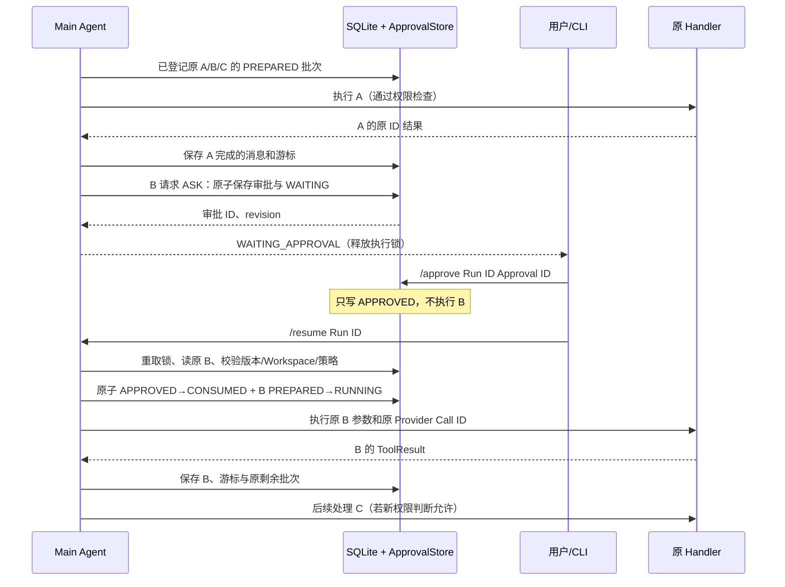

# HITL：权限决策、原始工具调用审批及跨进程恢复

> 基线 `5f41f1d09806ed8a4c387bd80b47a07adaa45609`。核心源码：`src/core/permissions.py`、`src/core/approvals.py`、`src/core/checkpoint_store.py`、`src/agent/mini_claude_agent.py`、`src/cli/hitl_commands.py`、`src/cli/entrypoint.py`。历史演进严格拆成 `2518787`（7A）、`f069085`（7B）、`342a523`（7C），不要把 7A 的纯 Store 契约说成当时已经能在 CLI 完成审批。

## 1. 为什么“危险 Tool 让人点同意”不是完整设计

LLM 决定调用 Shell 或写文件时，用户可能需要审批。但是一个审批必须绑定到**具体的一次工具调用及其执行上下文**，而不只是“这条命令名看起来安全”。考虑说明性场景（非已存档的真实人机对话）：模型依次请求 A=读取配置、B=修改配置、C=运行测试。系统执行 A 后，B 需要 ASK 审批，用户关闭 CLI、次日重启后选择批准。如果 Runtime 再把任务发给模型，模型可能重新生成参数不同的 B、把 C 顺序改掉，或重复执行已完成的 A；审批对象与真实工具执行失去绑定。正确目标是保存原始 B 的 Provider ID、参数、批次位置和剩余 C，批准后在核验相同工作区/handler/策略的前提下执行原 B，不再请求模型发明新 B。

审批还会引入第二种崩溃窗口：用户已经批准、`ApprovalStore` 已记录决定，但进程在 handler 运行前或之后退出。此时“批准过”绝对不能作为“可安全重复执行”的理由；必须与 [04](04_RunState快照与Checkpoint恢复.md) 的 `RUNNING→UNKNOWN` 协议一起工作。**HITL 解决授权问题，Checkpoint 解决执行事实问题，二者不互相替代。**

## 2. 阶段 7A：只有权限判断和持久审批契约

提交 `2518787fe6b4531ab8055774e3ae65373186700b` 建立 `ToolOperation`、`PermissionDecision`、`DefaultPermissionPolicy` 和 `ApprovalStore`，但当时没有把 ASK 接入 Agent 的正式执行循环。`ToolOperation` 绑定 `run_id`、`turn`、`ordinal`、原始 Provider Tool Call、Workspace、cwd 及环境上下文摘要；`PermissionDecision` 保存决策 `DENY`、`ALLOW` 或 `ASK` 及规则来源。Schema 对不合法参数、越界路径和禁用 Feature 要首先 DENY，而不是把不安全操作交给用户“点批准就绕过”。只有可核实的内置只读 handler 可以 ALLOW；写入、Shell、Todo、Note、skills 与不透明 handler 采取 ASK。

`ApprovalStore` 基于原有 SQLite `calls` 记录，新增审批状态 `PENDING`、`APPROVED`、`REJECTED`、`INVALIDATED`、`CONSUMED`。建立审批必须证实相应工具调用仍为 `PREPARED`，当前 Run 的批次/游标与原调用一致，且 `binding_digest` 覆盖当前操作上下文。审批的创建、决定、消费由持有 Run 锁者对原数据库提交；**用户点击“批准”本身不能运行 handler**。这也便于将授权行为与实际副作用操作分离审计。

该阶段的独立验证为新增权限与审批合计 66 项通过；完整单测历史报告为 543 passed、12 skipped、4 failed（Windows Python3.14.3）。这些测试只能说明权限/Store 契约有定向覆盖，不应说 7A 已经在 REPL 中支持真实用户审批。

## 3. 阶段 7B：ASK 真正进入原工具循环

提交 `f069085c9f072f8fd97511e05eb6b41f33e6aa29` 将 `_hitl_gate()` 加到 `MiniClaudeAgent._execute_tool()` 的分派前。需要首先明确 `enable_hitl()` 只能在无活动 Run 且已经启用 SQLite Checkpoint 的条件下调用；普通默认 Agent 不启用 HITL。工具请求抵达时，先绑定原调用及工作区/执行环境上下文，得到权限策略判断：

- `DENY`：返回明确的未执行控制结果。不会执行 handler，也不应当按真实工具运行失败记入 Runtime 失败治理。
- `ALLOW`：按正常 Checkpoint 流程把当前 `PREPARED` 转为 `RUNNING`，然后调用已注册 handler，保存结果与下一游标。
- `ASK`：创建持久审批请求和 `WAITING_APPROVAL` 状态，当前原工具调用保持 `PREPARED`；**不生成 Tool Result、不推进游标、不把未执行调用记成失败**，随后释放 Run 锁，等待外部决定。

等待写入由 `ApprovalStore.request_wait()` 在**同一 SQLite 事务**中保存 `ApprovalRecord` 和 WAITING 的 Snapshot 投影，事务提交后才更新内存 WAITING 状态。若内存状态抢先改成 WAITING 而数据库保存失败，就会产生不可恢复的假等待；这就是原子等待发布的根因。另一个细节是从批次 `seen_signatures` 中撤去尚未处理的当前调用签名，否则批准后继续 B 时，同批次去重机制会误判 B 已执行，直接跳过。

### 3.1 审批后原调用的确切时序

图描述**权限批准分支的机制**，不是一次真实操作的回放。批准与实际 handler 调用不在同一个原子事务里；`CONSUMED + RUNNING` 的提交只证明已授权且准备执行，随后进程若退出，仍然必须进入 UNKNOWN，禁止把已经消费的 Approval ID 当作重试凭证。代码是 `_checkpoint_dispatch()` 调用 `ApprovalStore.consume_and_mark_running()` 后再 `ToolRegistry.execute()`，而不是重新生成一条 Tool Call。`resume_checkpoint()` 先通过已有 Snapshot/Journal 协议恢复，把原来的 `ToolBatchState` 装回循环，使 Provider 请求只在批次结果完整闭合之后再继续。

## 4. 用户拒绝或授权失效时究竟如何处理

`REJECTED` 不能“伪造 B 成功”，也不能执行一个依赖于 B 的后续 C。当前 Runtime 为被拒原调用和剩余未执行项生成对应原 Tool Call ID 的连续 `NOT_EXECUTED` 结果，闭合该批次，再向模型写入重新规划反馈。拒绝是**用户决策**，不是 Shell 失败；它不该制造虚假的工具失败次数。这样消息格式保持合法，模型在下一轮知道 B/C 没执行，并可以选择其他不需该权限的方案。

`INVALIDATED` 处理的是原审批身份或兼容性不再成立，例如审批超过配置期限、工作区在等待期间变化、工具源码/Feature/策略与批准时不同。此时旧批准不被继承，不能把“重新打开同样的审批窗口”视为对新操作的自动授权。`CONSUMED` 则代表批准已被绑定到一次进入执行的原调用，不能再次消费；`UNKNOWN` 不能通过重新批准解除。它们分别表示不同的安全不变量，不应作为同一个“审批失败”模糊展示。

模型如果在审批窗口内试图输出新的工具请求，普通新消息不会改变那个等待中的 Run。Runtime 新 Run 前检查 `WAITING_APPROVAL`，拒绝用新用户输入悄悄覆盖待审批进度。CLI 的 `/clear`、`/compact` 也不得在未完成 Run 上擦除权威状态，防止展示层破坏执行层的恢复条件。

## 5. 阶段 7C：CLI 只是授权控制界面，不是另一个执行器

提交 `342a5232611a1db268f2351ef5f4d48dc1ee6676` 让用户能在本地 REPL 发现 Run、查看审批、做决定与显式恢复，新增 `src/cli/hitl_commands.py` 及 `entrypoint.py` 参数对接。首次 `--hitl --init-checkpoints` 明确初始化库；之后 `--hitl` 要求已有可验证数据库，`--checkpoint-db` 必须保持同一路径。关键命令语义：

| 命令 | 实际调用效果 |
|---|---|
| `/runs` | 只读查询已记录的 Run ID、状态和 Approval ID |
| `/approval <Run ID>` | 只读查询当前审批对象、参数、cwd、规则与状态 |
| `/approve <Run ID> <Approval ID>` | 保存批准事实，不 dispatch |
| `/reject <Run ID> <Approval ID>` | 保存拒绝事实，不 dispatch |
| `/resume <Run ID>` | 恢复原批次：重新加锁、校验并决定继续或拒绝 |

用户退出终端后用相同 Workspace/Checkpoint 数据库重新进入，先查询 `/runs`，再操作精确 Run ID 与 Approval ID；不能凭“最近一条审批”猜测多个 Run 的身份。CLI 不直接改写审批表/Journal、不自行分派 handler，不再建立一套并行的恢复状态机。`--resume RUN_ID` 是另一入口，但同样调用 Runtime 恢复契约，不能绕开旧库缺失检查。

审计期间发现 README 中的旧段落仍声称“没有 Resume CLI”，但同份 README 前面的命令表和 `src/cli/hitl_commands.py` 已提供 `/resume`，`docs/evolution/cli_command_boundary.md` 7C 记录了该功能；应将旧句标为历史文本残留，而不是当前功能缺失。

## 6. 信息安全：展示脱敏并不是数据加密

CLI 展示审批参数时，可能带 Shell 密码、带凭据的 URL 或 Token。7C 增加对终端展示、日志和部分诊断的保守脱敏，尽量不把敏感值复制到命令历史。但**真正要执行的原始参数必须完整保存**，否则审批和执行无法绑定相同调用。因此本地 SQLite、Snapshot、必要 Trace 仍可能包含原始参数。项目把它们视为可信本机数据，不提供磁盘加密、操作系统认证、服务器多租户隔离、通用秘密检测或 `actor` 实名认证；`actor` 只是调用方提供的审计标识。

同样，`DefaultPermissionPolicy` 的硬拒绝与 ASK 只保护主 Agent 当前正式调度入口：直接调用 `BaseTools`/`ToolRegistry`、某些后台 API 或冻结多 Agent 模块并不会自动进入相同 HITL 契约。工作区授权检查不是 OS 沙箱，策略校验与 Shell 启动之间也不是不可变的全局文件系统事务。

## 7. 验证证据、负面结果与尚未覆盖的环境

`docs/evolution/cli_command_boundary.md` 记载 7C 的 Windows Python3.14.3 冻结代码完整单测 `646 passed、12 skipped、4 failed`；新增 CLI 45 项全部通过，其中三项是真正独立 Python 进程、实际 CLI 入口与 Mock Provider 驱动的工作流（批准后退出重启继续、拒绝后闭合、活 handler 竞争/死亡转 UNKNOWN）。还涵盖连续 ASK、权限/Workspace/Handler 变化、过期、损坏库、展示脱敏等。该结果不等于“650 项全部通过”：四项历史失败和跳过必须继续显示。

历史第一次用 `PYTHONIOENCODING=utf-8` 运行时，旧 GBK 子进程 stderr 读取测试报错；之后有调整环境并复测、带引号命令名展示缺陷修复、Worktree CRLF oracle 归因。这些是测试环境与源码细节，不应被抹掉。“本次 GitHub 文档调查”没有再次执行这些测试，也没有进行人工真实 TTY 操作、Linux/POSIX HITL 实测、付费模型生成危险命令的端到端实验。因此只能称历史确定性集覆盖了主要状态协议，不能声称生产验证。

## 8. 当前有意保留的限制

HITL 默认关闭；主 Agent 必须先启用 SQLite。未授权的 B 不执行；经过批准也必须先以不可重放的 `RUNNING` 事实记录，再进入 handler。外部副作用无法与 SQLite 原子提交，遗留 RUNNING 仍为 UNKNOWN；用户只能人工核实，系统没有任意 UNKNOWN 的安全补偿接口。`INVALIDATED` 不提供“同一调用自动换发批准”的快捷通道，避免授权漂移；不同 handler/权限策略版本的旧 Run 可能无法继续，属于一致性取舍。

这条技术线与普通“弹窗问用户是否同意”的最大区别，是**保存原始意图、保存具体授权对象、保存进入执行的事实，并让三者在失败后仍能相互核对**。它依赖 Tool Registry 的准确 Schema/handler 绑定、RunState 的批次游标与 SQLite 的日志/锁约束。完整机制可从 [02_工具执行与扩展边界](02_工具执行与扩展边界.md) 与 [04_RunState快照与Checkpoint恢复](04_RunState快照与Checkpoint恢复.md) 前后串联阅读。
